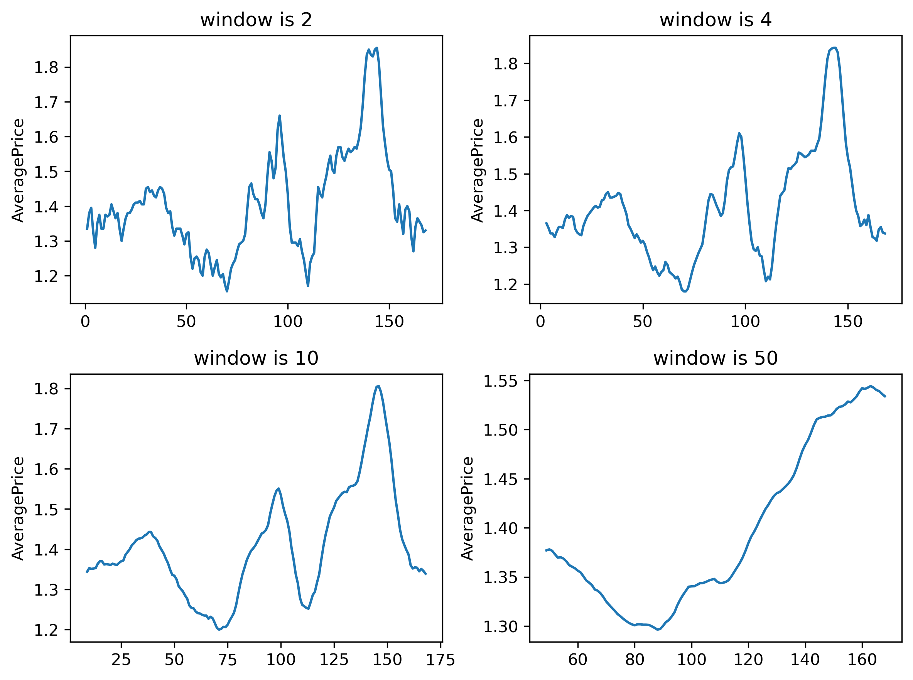
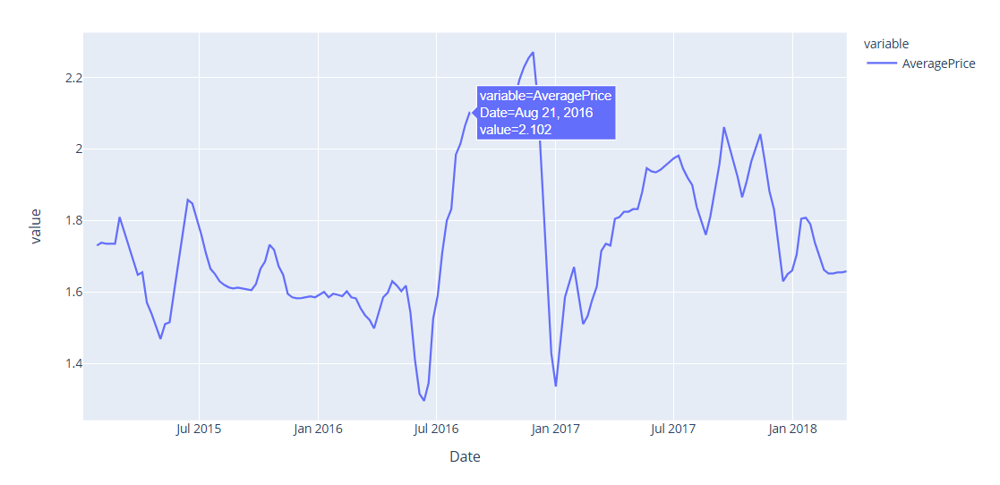

# Анализ средних цен на авокадо

(English version below)

## Бизнес-контекст
Агентство, специализирующееся на исследовании рынка продуктов питания, поручило исследовать тренды цен на авокадо и проанализировать средние значения. Данные предоставлены Hass Avocado Board — организацией, которая собирает статистику продаж авокадо в США.

Датасет содержит недельные наблюдения по регионам и типам авокадо (обычное и органическое) за период с января 2015 по март 2018 года. Для каждой даты есть несколько записей, различающихся по типу авокадо и региону продажи.

## Цель
Исследовать тренды цен на авокадо, проанализировать средние значения с помощью оконных функций (скользящее среднее и экспоненциальное скользящее среднее), построить интерактивные графики и преобразовать числовую переменную в категориальную для группировки значений.

## Источники данных
- **Date** — дата (конец недели)
- **AveragePrice** — средняя цена одного авокадо
- **Total Volume** — количество проданных авокадо
- **4046, 4225, 4770** — количество проданных авокадо с соответствующим PLU-кодом
- **Total Bags, Small Bags, Large Bags, XLarge Bags** — количество упаковок разного размера
- **type** — тип авокадо: обычное (`conventional`) или органическое (`organic`)
- **year** — год
- **region** — город или регион продажи

## Что сделано
- Загрузила данные и привела колонку `Date` к типу datetime.
- Посчитала среднюю цену по всем записям на каждую дату (169 недель).
- Рассчитала скользящее среднее с окном 3 и определила его максимальное значение.
- Сравнила влияние размеров окна (2, 4, 10, 50) на сглаживание ряда.
- Рассчитала экспоненциальное скользящее среднее (EWM) с `span=2`.
- Отобрала органические авокадо в Чикаго, посчитала для них скользящее среднее с окном 4 и построила интерактивный график в Plotly.
- Разбила цены на две группы относительно среднего значения через `pd.cut` и определила, каких цен больше.

## Ключевые выводы
- **Средняя цена за 4 января 2015 года** — 1.301296; данные покрывают 169 недель с января 2015 по март 2018.
- **Максимальное скользящее среднее (окно 3)** — 1.85, пик приходится на осень 2017 года.
- **Размер окна влияет на сглаживание:** окно 2 почти повторяет исходный ряд, окно 50 даёт максимально гладкую линию, но теряет локальные пики. Для анализа тренда оптимально окно 10–50.
- **EWM (span=2)** сглаживает ряд, но сохраняет реакцию на резкие изменения, и не даёт `NaN` в начале.
- **Органические авокадо в Чикаго:** 94 недели цена была ниже или равна среднему (1.7442), 74 недели — выше среднего. Пик цен — конец 2017 года (около 1.85), минимум — начало 2015 (около 1.73).

## Инструменты
- Python (Pandas, Seaborn, Matplotlib, Plotly)
- Jupyter Notebook

## Визуализации

*Скользящее среднее с окнами 2, 4, 10 и 50*

*Скользящее среднее (окно 4) для органических авокадо в Чикаго*

## Структура проекта

- `data/` — исходные данные (`avocado_full.csv`)
- `notebooks/` — Jupyter Notebook с полным анализом
- `visuals/` — ключевые графики и скриншоты
- `README.md` — описание проекта
- `requirements.txt` — зависимости

📓 [Открыть ноутбук с полным анализом](notebooks/analysis.ipynb)

# Analysis of average avocado prices

## Business context
A market research agency specializing in food products has commissioned a study of avocado price trends and an analysis of average values. The data was provided by the Hass Avocado Board — an organization that collects statistics on avocado sales in the US.

The dataset contains weekly observations by region and avocado type (conventional and organic) for the period from January 2015 to March 2018. For each date there are several records, differing by avocado type and sales region.

## Objective
Study avocado price trends, analyze average values using window functions (moving average and exponential moving average), build interactive charts, and convert a numeric variable into a categorical one for grouping values.

## Data sources
- **Date** — date (end of week)
- **AveragePrice** — average price of one avocado
- **Total Volume** — number of avocados sold
- **4046, 4225, 4770** — number of avocados sold with the corresponding PLU code
- **Total Bags, Small Bags, Large Bags, XLarge Bags** — number of bags of different sizes
- **type** — avocado type: conventional or organic
- **year** — year
- **region** — city or sales region

## What was done
- Loaded the data and converted the `Date` column to datetime.
- Calculated the average price across all records for each date (169 weeks).
- Calculated the moving average with a window of 3 and determined its maximum value.
- Compared the effect of window sizes (2, 4, 10, 50) on smoothing the series.
- Calculated the exponential moving average (EWM) with `span=2`.
- Filtered organic avocados in Chicago, calculated their moving average with a window of 4, and built an interactive chart in Plotly.
- Split prices into two groups relative to the mean using `pd.cut` and determined which prices are more common.

## Key takeaways
- **Average price for January 4, 2015** — 1.301296; the data covers 169 weeks from January 2015 to March 2018.
- **Maximum moving average (window 3)** — 1.85, the peak comes in autumn 2017.
- **Window size affects smoothing:** a window of 2 almost repeats the original series, a window of 50 gives the smoothest line but loses local peaks. For trend analysis, a window of 10–50 is optimal.
- **EWM (span=2)** smooths the series but still reacts to sharp changes, and produces no `NaN` at the start.
- **Organic avocados in Chicago:** for 94 weeks the price was at or below the average (1.7442), for 74 weeks — above average. Price peak — end of 2017 (about 1.85), minimum — beginning of 2015 (about 1.73).

## Tools
- Python (Pandas, Seaborn, Matplotlib, Plotly)
- Jupyter Notebook

## Visualizations

*Moving average with windows of 2, 4, 10, and 50*

*Moving average (window 4) for organic avocados in Chicago*

## Project structure

- `data/` — source data (`avocado_full.csv`)
- `notebooks/` — Jupyter Notebook with the full analysis
- `visuals/` — key charts and screenshots
- `README.md` — project description
- `requirements.txt` — dependencies

📓 [Open the notebook with the full analysis](notebooks/analysis.ipynb)
